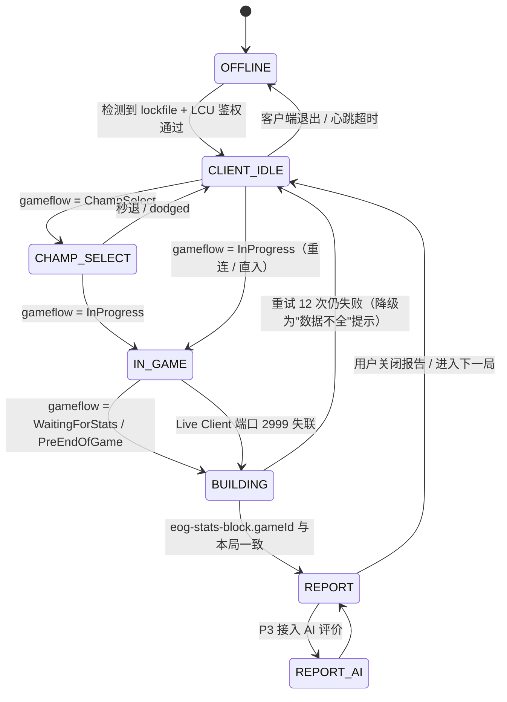

# 01 · 产品规格与状态机

> 产品：**LoL 战报**（工作名 `lol-review`）· 只做国服海克斯大乱斗
> **没有版本号。这是最终版。**

---

## 1. 一句话定义

一个**常驻桌面**的对局监测与复盘工具：从"客户端没启动"到"这局谁最蛆"，全程有界面、有状态、有结论。

---

## 2. 核心价值主张

| 现状痛点 | 本产品给的答案 |
|---|---|
| 打完一局，感觉"队友太菜"，但说不出谁菜、菜在哪 | 用 5 个官方数据维度算出 **CARRY / TEAM / RISK** 三条分，谁在尽力一眼看出 |
| 战绩网站只有 KDA、伤害、经济，没有"人设" | 每人一个**人设标签**（大腿 / 尽力 / 稳 / 混子 / 蛆）+ 一句话理由 |
| 数据是赛后的、静态的 | **赛前（选人）→ 赛中（实时）→ 赛后（报告）** 贯穿同一条时间轴 |
| 手动打开网站、手动搜 ID | 客户端一启动就自动接上，对局一结束就自动出报告 |

**不做什么**（非目标，防蔓延）：
- ❌ 不做自动接受对局 / 自动 ban pick / 自动操作（触发 Riot 反作弊红线）
- ❌ 不做任何"官方接口拿不到"的信息（敌方技能 CD、视野、未暴露装备）
- ❌ 不做抓取第三方战绩网站（op.gg / u.gg）
- ❌ P1-P2 不做账号体系与云端（纯本地，见 04 文档）

---

## 3. 状态机（这是全产品的主干）

整个 App 的生命周期 = 一个 6 状态 + 1 预留态的有限状态机。**所有界面都是状态的函数**，界面之间没有"自由导航"，只有"状态推进"。这是本项目最重要的架构决策，请后续实现严格守此约定。

### 3.1 状态定义表

| # | 代号 | 中文名 | 进入条件 | 用户看到什么 |
|---|---|---|---|---|
| S0 | `OFFLINE` | 客户端未启动 | 进程/锁文件不存在 | 全屏等待页 · 呼吸圆点 · "请启动英雄联盟客户端" |
| S1 | `CLIENT_IDLE` | 已连接 · 空闲 | lockfile 可读 + Basic Auth 通过 | 我的召唤师卡 + 最近 5 局 + "等待进入对局" |
| S2 | `CHAMP_SELECT` | 选人阶段 | `gameflow-phase = ChampSelect` | 5 张队友卡 + 倒计时 + 位置/备选 |
| S3 | `IN_GAME` | 对局进行中 | `gameflow-phase = InProgress` **且** Live Client 可达 | 双列实时计分板 + 经济差 |
| S3b | `IN_GAME_DEGRADED` | 对局中 · 敌方不可见 | InProgress 但 Live Client 返回受限 | 只显示我方 5 人 + 顶部"敌方数据受限"条 |
| S4 | `BUILDING` | 结算数据生成中 | `WaitingForStats` / `PreEndOfGame` / 2999 失联 | 居中说明卡 · 重试计数 · **不是骨架屏** |
| S5 | `REPORT` | 本局报告 | eog gameId 校验通过 | 结果横幅 + 三人组 + 全员评分带 |
| S5+ | `REPORT_AI` | AI 点评（P3） | 用户点"生成点评" | 报告页底部追加 AI 文案区 |

> **S3b 是必须存在的降级态，不是异常。** Riot Live Client Data API 对部分字段（尤其敌方装备细节）在非观战模式下可能不返回。设计上必须"缺失留空，绝不补 0"，否则会算出假的"敌方 0 伤害"。

### 3.2 状态转移的判定规则（写进代码的硬规则）

1. **推进靠推，不靠轮**：优先订阅 LCU WAMP `OnJsonApiEvent_lol-gameflow_v1_gameflow-phase`；轮询只做 1s 兜底与"客户端进程死了"的检测。
2. **进入 S4 需要双条件**：`gameflow ∈ {WaitingForStats, PreEndOfGame, EndOfGame}` **或** Live Client 2999 连续 3 次不可达。
3. **进入 S5 必须校验 gameId**：`eog-stats-block.gameId === session.gameData.gameId`。不一致说明还是上一局的数据，继续重试（最多 12 次 × 1s），超时进降级。
4. **S5 数据完整性阈值**：10 名玩家中 ≥ 8 人关键字段（伤害 / 承伤 / 治疗）非空，才标"完整"；否则报告顶部挂"数据不全"提示，人设标签降级为"待定"。
   > 大乱斗的视野 / 野怪 / 龙 / 男爵字段实测恒为 0，**不参与完整性判定**。
5. **模式白名单（2026-10-26 修订）**：本产品**只做海克斯大乱斗**（国服主玩模式），其余模式直接跳过并静默。
   - 主判定：`gameData.queue.id`（具体 ID 待实测，见 07 文档 V-01）
   - 兜底判定：`mapId = 12`（嚎哭深渊）+ `gameDuration < 25min`
   - **不要硬编码 queueId**，国服每次版本更新可能变。识别失败时宁可跳过，也不要按峡谷逻辑误算。
6. **重开局（ remake ）**：`gameDuration < 300s` 时不生成评分报告，只出一条"本局重开"提示。

---

## 4. 功能需求（按状态列）

### S0 · 客户端未启动
- F-01 每 2s 探测客户端进程（`LeagueClientUx`）与 lockfile 路径。
- F-02 支持用户手动指定客户端安装路径（部分自定义安装目录探测不到）。
- F-03 显示"上次连接时间 / 上次对局"作为兜底信息，避免空白页。
- F-04 手动"重试"按钮（预期用户点它 90% 是路径配错）。

### S1 · 已连接 · 空闲
- F-05 我的召唤师卡：头像、名称、等级、当前段位/胜点、最近 5 局战绩（胜率环）。
- F-06 显示"监听中"状态灯 + 本次运行累计监测局数。
- F-07 主动拦一下：如果客户端语言/大区异常导致接口字段缺失，显示诊断入口（P0 只记录日志）。

### S2 · 选人阶段
- F-08 我方 5 人卡片：位置、召唤师名、段位、最近战绩胜率、当前选的英雄。
- F-09 敌方只做"人数占位"（选人阶段拿不到具体信息，这是接口限制，不硬凑）。
- F-10 ban 列表展示（`actions` 中 `type=ban`）。
- F-11 秒退时回到 S1，不产生垃圾记录。

### S3 · 对局中
- F-12 双列计分板：头像、英雄、等级、KDA、CS、装备、召唤师技能。
- F-13 顶部实时：游戏时间、我方/敌方总经济差（用装备价值差代理）、人头差、防御塔数。
- F-14 每人 3 条微型评分条（CARRY / TEAM / RISK）实时更新 —— **这是"一眼看出"的核心组件**，见 03 文档。
- F-15 敌方数据缺失时进 S3b。
- F-16 不做"操作建议"类提示（合规 + 干扰）。

### S4 · 结算生成中
- F-17 居中说明卡 + 重试次数 + "第 N 次重试，正在等官方结算数据落库"。
- F-18 **延迟 1.2s 才出现**（避免 3 秒内完成的局闪一下全屏卡）。
- F-19 失败降级：明确告知"本局数据不全"，并给出"用赛中抓到的数据生成简版报告"按钮。

### S5 · 报告
- F-20 结果横幅：胜/负、时长、KDA 汇总、队列。
- F-21 **三人组**：MVP（最佳）、尽力局长（输局表现最好那个）、犯罪嫌疑人（最蛆）。
- F-22 全员 5 行评分带（CARRY / TEAM / RISK 三条 + 人设标签 + 一句话理由）。
- F-23 关键事件时间线：每次白给阵亡、每座塔的得失、关键团战，标注"此死亡后 45 秒内丢了一座塔"。
- F-24 展开某人 → 该人 12 项明细数据 + 与队友均值的 z 偏差。
- F-25 导出：把报告存为本地 JSON（P2）/ 长图 PNG（P3）。

### S5+ · AI 评价（P3）
- F-26 一键生成：团队总结（≤80 字）+ 每人一句人设点评（≤25 字）+ MVP 颁奖词。
- F-27 严格约束：只用传入的结构化指标，不允许编造数字；语气可玩梗，禁止人身攻击。
- F-28 缓存：同一 gameId 只生成一次，存本地；用户可"重新生成"（计次）。

---

## 5. 验收标准（可测）

| # | 场景 | 期望 |
|---|---|---|
| A-01 | 冷启动且客户端未开 | 3s 内进入 S0，CPU 占用 < 1% |
| A-02 | 启动客户端 | 15s 内自动进 S1，无需任何点击 |
| A-03 | 进选人 | 5s 内出 5 张队友卡（段位允许"未知"） |
| A-04 | 进对局 | 10s 内出实时计分板，刷新 ≤ 2s |
| A-05 | 对局结束 | 20s 内进 S5，或给出明确降级原因 |
| A-06 | 连续 3 局 | 报告不串数据（gameId 去重生效） |
| A-07 | 客户端中途退出 | 5s 内回 S0，不崩、不留悬空定时器 |
| A-08 | 敌方字段缺失 | 走 S3b，无 0 值伪造 |
| A-09 | 无网络 | 全功能可用（纯本地接口） |
| A-10 | 报告页可读性 | 5 秒内说出"谁最菜"，10 秒内说出"为什么" |

**A-10 是全产品的北极星验收项。** 如果 5 秒说不出来，UI 就失败了，回去改 03 文档。

---

## 6. 合规红线（必须写进 README 和关于页）

1. 只读 **Riot 官方提供的本地接口**（LCU + Live Client Data API），不注入进程、不读内存、不改包。
2. 不展示官方接口未暴露的隐藏信息（敌方技能 CD、敌方视野、草丛视野）。
3. 不做任何自动化输入（自动接受、自动选人）。
4. 不将 API 数据用于训练或对外售卖；AI 评价只在本地或用户自己的 key 下运行。
5. 遵守 Riot Third-Party Applications 政策；关于页挂免责声明。

---

## 7. 里程碑

| 阶段 | 内容 | 产出 |
|---|---|---|
| **P0（当前）** | 文档：产品 / 设计系统 / 界面 / 技术 / 评分模型 | 6 份 md |
| P1 | 连接层 + S0/S1/S3b 状态机 + 原始数据可视化 | 能连上、能看到对局 |
| P2 | S2/S3/S4/S5 全链路 + 评分模型 | 能出报告 |
| P3 | AI 评价 + 导出长图 | 能说人话 |
| P4 | 历史库 + 多局对比 + 可选云端 | 能复盘趋势 |

---

## 8. 运行形态（2026-10-26 决策）

产品**同一套状态机，三种界面投影**，用户在设置页自选：

| 形态 | 尺寸 | 支持状态 | 定位 |
|---|---|---|---|
| W1 主窗 | 1180×760（min 960×640） | S0–S5 全部 | 完整功能画布 |
| W2 悬浮条 | 420×168 固定置顶 | S1 / S3 | 游戏旁边的常驻一眼 |
| W3 游戏内叠加 | 320–560 自适应，点击穿透 | 仅 S3 | 局中不切窗口 |

**铁律**：形态切换不重置状态机、不重连接口、不丢数据。详见 `06-window-modes.md`。

这意味着 §3 的状态机与 §4 的功能需求**完全不感知形态**——需求按状态写，不按窗口写。任何"这个功能只在某个形态有"的描述都属于 06 文档。

运行平台：**先在 macOS 开发，最终只在 Windows 运行**。因此 P1 必须同时交付平台抽象层与 Mock 数据层（见 04 §9），否则 Mac 上完全没有客户端可测。

---

## 9. 未决问题

见 `README.md` § 剩余待讨论（Q-01 ~ Q-05），均不阻塞静态稿。
